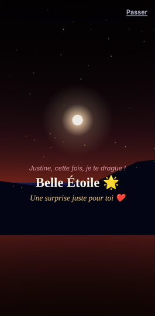
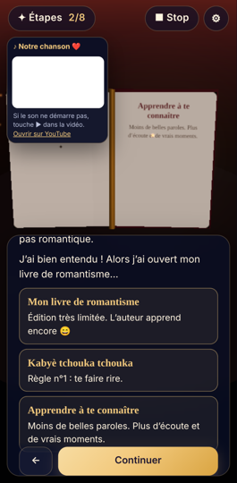
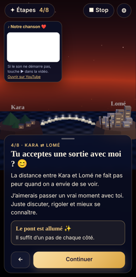
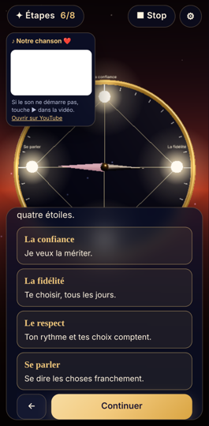
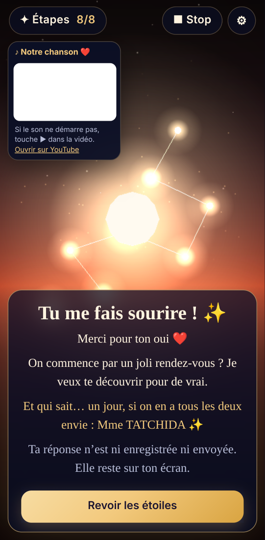

# Opération Belle Étoile 🌟 — « Le chemin vers nous »

Expérience Web 3D interactive, mobile-first (Android en portrait), en 8 étapes reliées par une carte-constellation, qui se termine par une question ouverte et trois réponses libres.

**En ligne :** https://louistatch.github.io/louis/belle-etoile/

Le code source est dans `belle-etoile-src/`. Le site compilé, publié par GitHub Pages depuis `main`, est dans `belle-etoile/`. Le projet ne touche ni au site racine du dépôt ni aux dossiers `togo-life-3d*`.

## Démarrer

```bash
cd belle-etoile-src
npm install
npm run dev        # http://localhost:5173 (accessible depuis le téléphone sur le même Wi-Fi)
npm run build      # TypeScript + build de production dans ../belle-etoile/ (à committer pour publier)
npm run preview    # sert ../belle-etoile/ sur http://localhost:4173
npm test           # tests unitaires de la progression (Vitest)
npm run e2e        # parcours complet sur émulation Pixel 7 (Playwright, après npm run build)
```

Pour Playwright, le Chromium utilisé est `/opt/pw-browsers/chromium-1194/...`. Vous pouvez en indiquer un autre avec `PW_CHROMIUM=/chemin/vers/chrome`. Avec `SHOTS=1 npm run e2e`, des captures sont enregistrées dans `e2e/screens/`.

## Partager en privé

Le build (`../belle-etoile/`) est un site statique sans serveur, sans compte et sans traceur. Il fonctionne dans n'importe quel sous-dossier (`base: './'`).

- **Actuellement :** GitHub Pages, à l'adresse ci-dessus. Pour mettre à jour : `npm run build`, puis commit et merge sur `main`.
- **Plus privé :** Netlify ou Vercel (glisser-déposer `../belle-etoile/`) avec une protection par mot de passe, puis envoyer le lien à la main.
- **Attention :** un dépôt public reste lisible par tous. Les balises `noindex` et `robots.txt` évitent l'indexation par les moteurs de recherche, mais **n'empêchent pas** une personne qui a le lien d'ouvrir la page.

## Architecture

| Élément | Fichier |
|---|---|
| Toute la narration (textes modifiables) | `src/content/story.fr.ts` |
| Progression déterministe et testable (fonctions pures) | `src/state/journey.ts` |
| Store Zustand et sauvegarde locale de la progression | `src/state/journeyStore.ts` |
| Réglages (son, animations, qualité, exploration) | `src/state/settings.ts` |
| Coque, chargement différé de la 3D, swipe, bascule sans WebGL | `src/App.tsx` (`ExperienceShell`) |
| Canvas, caméra à trajectoire douce, `QualityManager` | `src/three/SceneCanvas.tsx` |
| Carte mentale 3D (8 nœuds reliés) | `src/three/StarMap3D.tsx` |
| Ciel, étoiles, halos, lucioles, étiquettes | `src/three/common.tsx`, `src/three/textures.ts` |
| Scènes | `src/three/scenes/*Scene.tsx` |
| Interface (récit, carte, choix, réglages, version légère) | `src/ui/*` |

**Scènes :** CP0 intro (collines et Belle Étoile), CP1 bulle « Hello » qui allume une étoile, CP2 livre aux pages qui se tournent, CP3 jardin et 3 lanternes, CP4 Kara et Lomé avec un pont qui se construit depuis les deux rives, CP5 valise et arche d'horizon, CP6 boussole « Confiance » à 4 étoiles, CP7 promenade, table à deux, arche et constellation « 2027 », CP8 étoile suspendue, lettre et trois choix.

**Interactions :**
- Toucher les objets 3D (bulle, livre, lanternes, rives, valise, étoiles de la boussole, nœuds de la carte).
- Chaque élément a aussi un bouton équivalent dans la carte de texte : l'expérience reste utilisable au lecteur d'écran, sans 3D et sans précision tactile.
- Glisser à gauche ou à droite pour l'étape suivante ou précédente.
- Option « Explorer » : glisser pour tourner autour de la scène. Elle remplace le joystick, plus encombrant sur un petit écran.

**Les trois réponses :**
- **« Oui, j'accepte ❤️ »** : constellation dorée et message « Alors commençons par un vrai rendez-vous… ». Le clin d'œil « Mme TATCHIDA », formulé au conditionnel, n'apparaît que si elle le demande.
- **« J'aimerais qu'on en parle 💬 »** : « J'aimerais t'écouter. Aucune réponse n'est urgente. », puis retour à la constellation.
- **« Je préfère ne pas m'engager »** : « Merci… Je respecte entièrement ton choix. », puis fin du parcours.

Les trois boutons ont la même taille et restent toujours cliquables. « Oui » est mis en valeur : une lueur douce, et l'étoile qui s'illumine quand le doigt s'en approche. Il n'y a ni minuteur, ni bouton qui s'échappe, ni redirection vers « oui ».

Après chaque réponse, le bouton **« Envoyer ma réponse à Louis 💬 »** ouvre WhatsApp vers le +228 92 54 88 38 (`WHATSAPP_NUMBER` dans `story.fr.ts`), avec un message déjà écrit selon la réponse. **Rien n'est envoyé automatiquement :** c'est elle qui appuie sur Envoyer dans WhatsApp.

## Performance (mobile, réseau limité)

- **Aucun modèle ni texture à télécharger :** toute la 3D est procédurale (géométries simples, instanciation de l'herbe, shaders légers). Les textes 3D sont dessinés dans un canvas, sans police externe.
- **Poids mesuré (gzip) :** environ 57 Ko pour le texte d'intro (HTML, CSS et JS de l'interface), puis environ 235 Ko pour la 3D (three.js, react-three-fiber, scènes), chargée après coup. Total environ 290 Ko.
- **Rendu :** pas de post-traitement ni d'ombres dynamiques. Les halos lumineux sont des sprites additifs plutôt qu'un bloom. Une seule scène est montée à la fois.
- **Qualité :** les niveaux low, medium et high règlent le plafond de `devicePixelRatio` (1, 1,5 ou 2), le nombre d'étoiles, de lucioles et de brins d'herbe, et l'antialiasing. Le mode auto choisit selon les cœurs et la mémoire de l'appareil, puis **baisse d'un cran si la fréquence moyenne passe sous 28 i/s**. La fréquence mesurée s'affiche dans Réglages.
- **Accessibilité :** l'option « Réduire les animations » (activée d'office si le système le demande) coupe le balancement de la caméra, les flottements et le scintillement. Le texte fait au moins 15 px et les zones tactiles au moins 44 px. La mise en page s'adapte au portrait comme au paysage.

**Limites connues :**
- Les fréquences n'ont pas été mesurées sur un vrai téléphone Android. Les tests tournent dans Chromium avec un rendu WebGL logiciel (SwiftShader), qui ne dit rien des performances réelles. À vérifier sur l'appareil cible, avec Réglages pour lire la fréquence.
- three.js reste la plus grosse dépendance (environ 175 Ko gzip).
- Pas de PWA ni de mode hors ligne.
- **Chanson :** la vidéo YouTube `PSZTZwoIJEc` (modifiable via `SONG_ID` dans `story.fr.ts`) est créée au toucher de « C'est parti ». Ce geste autorise la lecture automatique avec le son sur la plupart des Android. Sur iPhone, ou si le navigateur bloque, il faut toucher ▶ dans la vidéo. Le bouton « ■ Stop / ♪ Chanson » en haut l'arrête ou la relance. Elle tourne en boucle.

## Confidentialité

- Pas de statistiques, pas de police distante, pas d'API. **Seule exception : la chanson**, lue par le lecteur YouTube officiel (`youtube-nocookie.com`), visible en haut à gauche. YouTube peut collecter des données de lecture.
- Seule la **progression** (étapes visitées et éléments révélés) est gardée dans le `localStorage` du téléphone, pour pouvoir reprendre. La **réponse finale n'est jamais enregistrée** : elle reste à l'écran le temps de la session (vérifié par les tests). Le bouton « Recommencer » efface tout.
- L'archive `Discussion_WhatsApp_avec_Belle_Etoile__.zip` n'a pas été ouverte : les citations déjà validées dans le cahier des charges suffisaient. Elle est exclue de Git via `.gitignore` (à la racine du dépôt et dans `belle-etoile-src/`).
- Aucune photo, voix ou représentation de Justine. Les personnages sont des silhouettes anonymes.

## Personnaliser

- **Textes :** tout est dans `src/content/story.fr.ts` (titres, paragraphes, éléments à révéler, réponses, messages de fin).
- **Cadrages et couleurs de ciel :** `SHOTS` dans `src/three/SceneCanvas.tsx`.
- **Budgets de qualité :** `budget()` dans `src/state/settings.ts`.
- **Disposition de la constellation :** `NODE_POSITIONS` dans `src/three/StarMap3D.tsx`.

## Captures (émulation Pixel 7)

    


